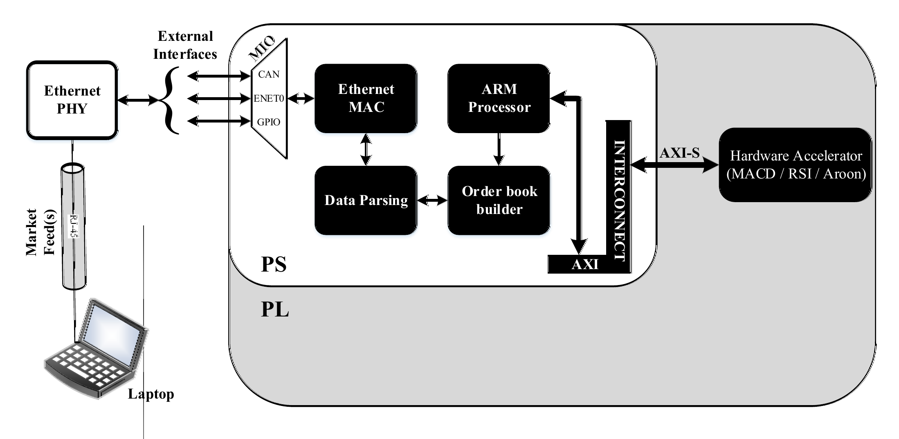
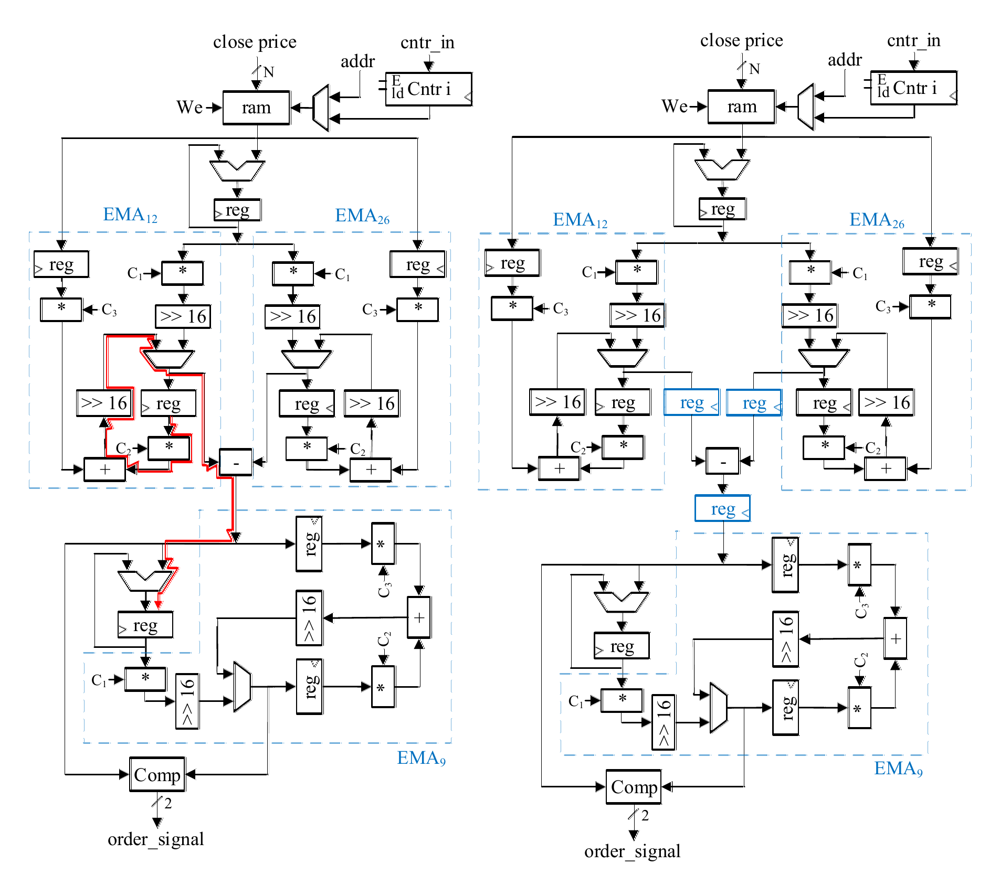

High-frequency trading competes on microseconds, yet no hardware implementations
of the standard technical indicators existed in the literature. Designed the first
documented architectures for **Aroon, MACD and RSI** on Xilinx Zynq SoC, with the
latency-critical datapaths in programmable logic and everything else in software
on the ARM core.

<figure>
  
  <figcaption>Market data enters over Ethernet, the PS parses it and builds the order book, and the indicator accelerators sit in the PL behind AXI-Stream.</figcaption>
</figure>

**The division problem**

MACD required six hardware dividers, and synthesis time had become impractical.
Rather than spend area on them, reformulated the smoothing constants so each
division collapsed into a **constant multiply and a right shift** — which costs
nothing in hardware. All six dividers removed, and the longest path shortened.

<figure>
  
  <figcaption>MACD critical path before (left, in red) and after (right) replacing the dividers with constant multiply-and-shift.</figcaption>
</figure>

**Results**

| | |
|---|---|
| Speed-up over the ARM software baseline | **30×** |
| MACD and RSI throughput | within **0.38 µs** of each other — close enough to run concurrently |
| RSI divider microarchitectures compared | 3, from combinational to fully pipelined |
| Latency techniques | critical-path analysis, pipelining, folding, circuit replication |
| Platform | Xilinx Zynq-7000 SoC (ZedBoard) |

**My role** — lead designer and first author: indicator architectures, the
divider reformulation, critical-path optimisation, and the PS-vs-PL comparison.

**Tools** — VHDL, Vivado, ModelSim, MATLAB reference models, C on the ARM core
for the software baseline.

**Links** — [paper (Alexandria Engineering Journal, 2024)](https://doi.org/10.1016/j.aej.2024.03.064) ·
[code: FYP_project](https://github.com/CodeWithAbbas/FYP_project) ·
[diagrams and docs: Academic-Work](https://github.com/CodeWithAbbas/Academic-Work)
