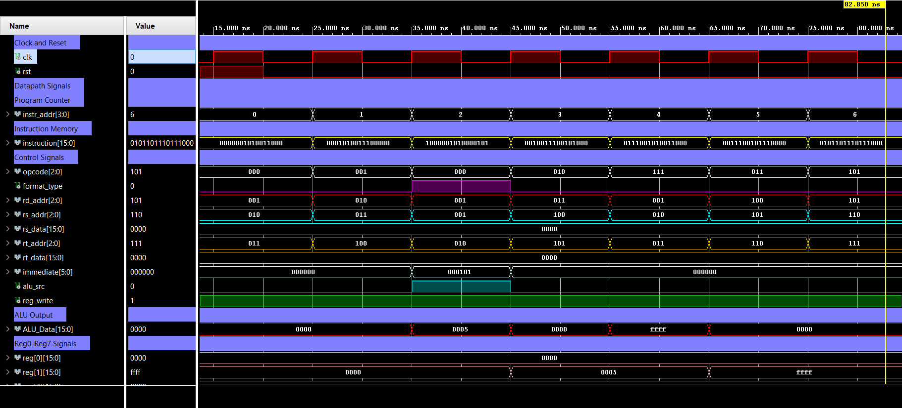

#### 16-bit single-cycle CPU in VHDL

Full datapath on Zynq-7020 — ALU with eight operations, 8×16-bit dual-read register
file, 16-entry instruction memory, program counter and control unit, with R-type and
I-type instruction formats. Functionally verified in simulation and timing-closed.

<figure>
  
  <figcaption>Behavioural simulation: instruction fetch, decode fields, control signals and ALU result across the first seven instructions.</figcaption>
</figure>

| Synthesis on Zynq-7020 (xc7z020) | |
|---|---|
| LUTs | 207 / 53,200 (0.39%) |
| Flip-flops | 132 / 106,400 (0.12%) |
| I/O | 18 / 200 |
| Maximum clock frequency | **143.0 MHz** |
| Worst negative slack | +0.114 ns |
| Worst hold slack | +0.355 ns |

**Tools** — VHDL, Vivado synthesis and implementation, behavioural simulation.
[code](https://github.com/CodeWithAbbas/Comp_Arch_Project) *(ECE 575)*

#### CNN accelerator on PYNQ-Z2

Hardware/software co-design taken end to end: PyTorch training (**95.80% accuracy**
on the 43-class GTSRB dataset), Vitis HLS synthesis, INT8 quantisation and AXI
deployment. **89% hardware accuracy at 101 MHz** using 55% of available LUTs.
**Tools** — PyTorch, Vitis HLS, Vivado, PYNQ. *(ECE 554)*

#### MNIST neural network in RTL

Pipelined MAC engines in VHDL for a fully-connected network. Fixed-point weights
held in BRAM, deployed on Zynq-7020 over AXI-Stream with ARM DMA.
**Tools** — VHDL, Vivado, AXI-Stream, ARM DMA. *(ECE 5752)*

---

Related journal work compares machine learning models for financial time-series
prediction, published in [*PLOS ONE* (2023)](https://doi.org/10.1371/journal.pone.0286362).
